<!--
  RetailPulse — Project Report
  Source of truth for the project documentation PDF.
  Edit this Markdown; regenerate the PDF from it. Image paths are repo-relative.
-->

  <header class="cv-head">
    ZIDIO&nbsp;DEVELOPMENT
    Internship Project · 2026
  </header>

  

    
Project Report

    <h1 class="cv-title">RetailPulse</h1>
    

    
AI-Powered Customer Analytics &amp; Demand Forecasting Platform

    
An end-to-end retail intelligence system — customer segmentation,
    demand forecasting, churn prediction, and inventory optimization, delivered through
    an interactive dashboard backed by a full MLOps pipeline.

  

  <footer class="cv-foot">
    <ul class="cv-stats">
      <li><b>779K</b>transactions</li>
      <li><b>5,878</b>customers</li>
      <li><b>₹17.4M</b>revenue analyzed</li>
      <li><b>6</b>ML models</li>
    </ul>
    

      

        <b>Tanmay Patel</b>
        Data Science &amp; Analytics Intern · Zidio Development · June 2026
      

      <a class="cv-demo" href="https://retail-pulse-ai.streamlit.app">retail-pulse-ai.streamlit.app</a>
    

  </footer>

---

## 1. Project Overview

**Vision & objectives.** RetailPulse is an AI-powered retail analytics platform that ingests a year of raw transaction data and answers four core business questions through a single interactive dashboard backed by a production-grade MLOps pipeline:

| Business question | How RetailPulse answers it |
|---|---|
| **Who are my customers?** | RFM scoring + K-Means / DBSCAN segmentation |
| **What will I sell next?** | Prophet + LSTM hybrid demand forecasting |
| **Who is about to leave?** | XGBoost churn model tuned with Optuna |
| **What should I restock?** | EOQ, safety-stock & reorder-point optimization |

It additionally estimates **customer lifetime value** (BG/NBD + Gamma-Gamma), generates **natural-language insights** (LLM-powered), and runs an **automated retraining pipeline** that retrains models when data drift is detected.

**Target users / use cases.**
- **Executives** — a unified command center with health scorecards, revenue-at-risk, and recommended actions.
- **Analysts** — segmentation, churn, and forecasting views for campaign and demand planning.
- **Data scientists** — model diagnostics, SHAP explainability, and MLflow experiment tracking.
- **Operations** — inventory reorder queue and threshold-based stockout / churn / revenue alerts.

**Business value delivered.** Built on a real dataset of **779,426 transactions**, **5,878 customers**, and **36,969 orders** (₹17.37M total revenue), the platform surfaces **₹8.08M of projected 12-month customer lifetime value**, flags customers at churn risk with high recall, and identifies the units needing reorder across the catalog — converting raw history into prioritized, revenue-protecting actions.

**Non-functional goals.**
- **Accuracy gate** — releases blocked if churn AUC or forecast error regress below `models/baseline_metrics.json`.
- **Responsiveness** — three-layer data cascade (Redis cache → PostgreSQL → CSV fallback) keeps the dashboard fast and degrades gracefully if a backing service is down.
- **Scalability** — containerized stack with Kubernetes manifests for horizontal scaling.
- **Security** — JWT authentication with four roles; every page enforces login and role permission; no secrets committed.

---

## 2. Key Features

| ID | Feature | Description | Acceptance Criteria |
|----|---------|-------------|---------------------|
| F1 | Customer segmentation | RFM scoring with K-Means + DBSCAN, profiled into business labels (Champions, Loyal, Churned, Outlier) | Every customer assigned a cluster + business label; clusters reproducible from `run_segmentation` |
| F2 | Demand forecasting | Prophet + LSTM residual hybrid forecasts daily revenue | Hybrid beats baseline on validation; MAPE / MAE / RMSE logged to MLflow |
| F3 | Churn prediction | Optuna-tuned XGBoost with SHAP explainability and per-customer probabilities | Test AUC ≥ baseline (0.928); SHAP ranking produced for every model |
| F4 | Inventory optimization | EOQ, safety stock & reorder points from forecasted demand | Each SKU classified (optimal / stockout-risk / overstock) with units-to-order |
| F5 | Customer lifetime value | BG/NBD + Gamma-Gamma 12-month CLV with probability-alive | CLV + P(alive) produced for every active customer |
| F6 | Interactive dashboard | Multipage Streamlit app — overview, segmentation, churn, forecasting, inventory, CLV, alerts, command center | All pages render with DB or CSV fallback; no hard dependency on a live service |
| F7 | Role-based access control | JWT auth, four roles, per-page permission enforcement | Unauthorized role blocked from restricted pages; session persists across refresh |
| F8 | AI insights & alerts | LLM-generated briefings, NL Q&A, threshold email alerts (churn / stockout / revenue) | Alerts fire on threshold breach; sends logged to history |
| F9 | MLOps loop | MLflow tracking, Evidently drift detection, Airflow drift-triggered retrain behind an accuracy gate | Drift report generated; retrain only promotes models that clear the gate |
| F10 | CI/CD & deployment | Lint + test + accuracy gate → image build → Kubernetes deploy; hosted on Streamlit Cloud | Accuracy regression blocks release; green pipeline deploys automatically |

---

## 3. Technology Stack

| Category | Technology | Rationale / Alternatives |
|----------|-----------|--------------------------|
| Forecasting | **Prophet + PyTorch Lightning (LSTM)** | Prophet captures trend/seasonality interpretably; LSTM models the residual non-linearity. *Alt: ARIMA (weaker on multi-seasonality), pure LSTM (less interpretable).* |
| Churn | **XGBoost + Optuna** | Strong tabular performance, native feature importance; Optuna for efficient hyperparameter search. *Alt: LogisticRegression (lower AUC), RandomForest.* |
| Segmentation | **scikit-learn (K-Means, DBSCAN)** | K-Means for clean business segments, DBSCAN to catch outliers. *Alt: hierarchical clustering (costlier at scale).* |
| Lifetime value | **lifetimes (BG/NBD + Gamma-Gamma)** | Established probabilistic CLV models for non-contractual retail. *Alt: heuristic historical CLV (no forward projection).* |
| Explainability | **SHAP** | Per-customer, theory-grounded attributions for the churn model. |
| Experiment tracking | **MLflow** | Metrics, params & artifacts per run; backs the release-gate baseline. |
| Drift detection | **Evidently AI** | Ready-made data/target drift reports feeding the retrain trigger. |
| Orchestration | **Apache Airflow** | DAG schedules drift checks and gated retraining. |
| Dashboard | **Streamlit + Plotly** | Fast multipage analytics UI in pure Python; Plotly for interactivity. |
| Auth | **JWT** | Stateless role-based access control across pages. |
| Data stores | **PostgreSQL + Redis** | Postgres as source of truth; Redis cache for low-latency reads. |
| Infra | **Docker Compose, Kubernetes** | Reproducible local stack and scalable cluster deploy. |
| Monitoring | **Prometheus + Grafana** | Metrics scraping and dashboards. |
| CI/CD | **GitHub Actions, Ruff, pytest** | Lint + test on every push; accuracy-gated deploy. |
| Hosting | **Streamlit Cloud + Supabase + Upstash** | Managed demo: Streamlit Cloud app, Supabase Postgres, Upstash Redis (TLS). |

---

## 4. Architecture Overview

High-level data flow and MLOps pipeline:

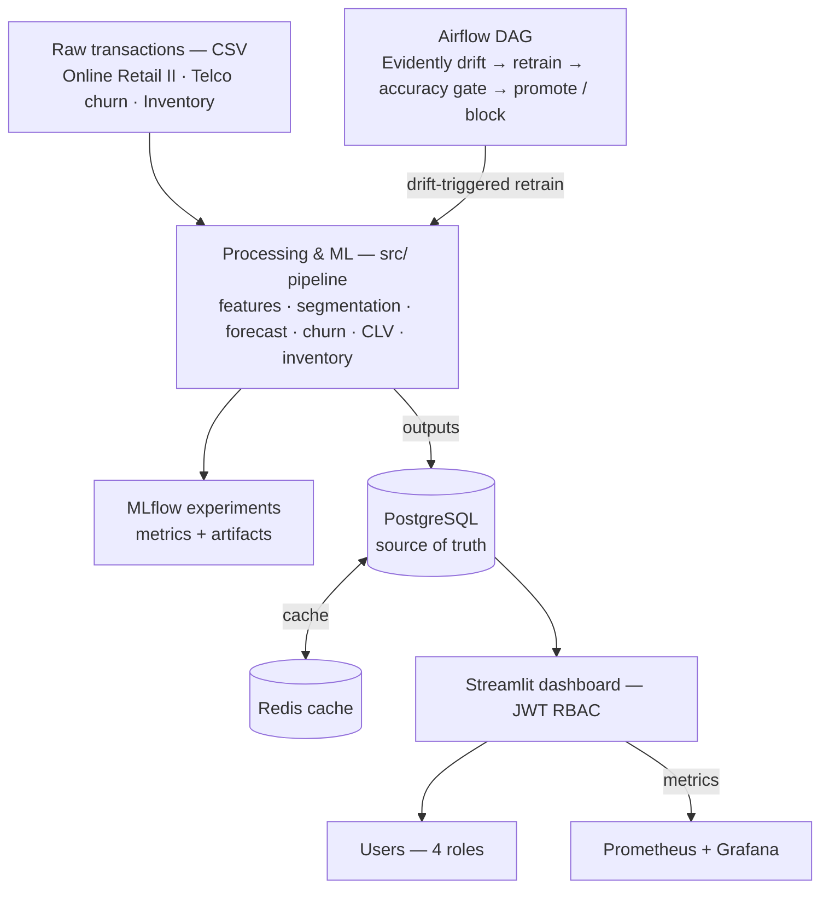

**Data flow.** Loaders read through a three-layer cascade — **Redis cache → PostgreSQL (source of truth) → CSV fallback** — so the app stays responsive and degrades gracefully if a backing service is unavailable. The ML pipeline (`src/`) writes processed outputs and logs every run to MLflow; the Airflow DAG retrains behind an accuracy gate when Evidently detects drift.

---

## 5. Detailed Execution Timeline

A 4-week internship build, executed day-by-day:

### Week 1 — Foundation & baseline models
| Day | Deliverable |
|-----|-------------|
| 1–2 | EDA, data cleaning, feature engineering, validation utilities + README |
| 3 | Customer segmentation — K-Means & DBSCAN |
| 4 | Time-series forecasting prep pipeline |
| 5 | Baseline Prophet demand forecast |
| 6 | LSTM forecaster (PyTorch Lightning) |
| 7 | **Checkpoint:** EDA report, cleaned dataset, baseline models logged to MLflow |

### Week 2 — Advanced models & MLOps core
| Day | Deliverable |
|-----|-------------|
| 8 | Hybrid forecasting (Prophet + LSTM ensemble) |
| 9 | Churn model (XGBoost + SHAP explainability) |
| 10 | Inventory optimization from forecasted demand |
| 11 | Feature-importance analysis + Optuna tuning |
| 12 | Drift detection (Evidently AI) |
| 13 | Automated retraining pipeline (Airflow) |
| 14 | **Checkpoint:** forecasting & churn models ready, optimization logic implemented |

### Week 3 — Dashboard
| Day | Deliverable |
|-----|-------------|
| 15 | Streamlit skeleton — multipage layout |
| 16 | Forecasting visualizations + what-if analysis |
| 17 | Segmentation & churn-risk dashboard |
| 18 | Inventory recommendations UI |
| 19 | Real-time metrics & alerts |
| 20 | Export functionality (CSV / PDF) — **Week 3 complete** |

### Week 4 — Production, infra & deployment
| Day | Deliverable |
|-----|-------------|
| 21–22 | Role-based access (4 roles), PostgreSQL integration, project hardening |
| 23 | CI/CD pipeline, Kubernetes manifests, Docker multi-stage builds |
| 24–25 | Streamlit Cloud deployment + Supabase migration; refresh/session & data-fallback fixes |
| 26 | Prometheus + Grafana monitoring |
| 27 | Load testing, final accuracy validation, accuracy gate as a CD release gate |

**Milestones:** Week-1 baseline models ✓ · Week-2 MLOps loop ✓ · Week-3 full dashboard ✓ · Week-4 production deploy + monitoring ✓.

---

## 6. Technical Highlights

### Model performance (real values, from MLflow)

**Churn — Optuna-tuned XGBoost**

| Metric | Value |
|--------|-------|
| Test AUC-ROC | **0.927** |
| Cross-val AUC | 0.945 |
| F1 | 0.816 |
| Recall | 0.970 |
| Precision | 0.704 |
| Precision @ top-20% | 0.766 |

High recall (0.97) is intentional — the cost of missing a churner outweighs a false alarm, so the model is tuned to catch nearly all at-risk customers.

**Demand forecast — Prophet + LSTM hybrid**

| Metric | Value |
|--------|-------|
| MAPE | 31.2% |
| MAE | ₹10,922 |
| RMSE | ₹18,981 |

**Customer lifetime value (BG/NBD + Gamma-Gamma)**

| Metric | Value |
|--------|-------|
| Mean 12-month CLV | ₹1,930 |
| Median 12-month CLV | ₹872 |
| Total projected CLV | ₹8.08M |
| High-value customers | 33% |
| Mean P(alive) | 0.82 |

**Inventory optimization**

| Metric | Value |
|--------|-------|
| SKUs at optimal stock | 38.75% |
| SKUs at stockout risk | 61.25% |
| Total units to order | 931,134 |

**Segmentation (5,878 customers).** K-Means produced three actionable segments plus outliers: **Loyal Customers (2,509)**, **Churned (1,862)**, **Champions (1,469)**, **Outliers (38)**; DBSCAN isolated the same 38 outliers from a dense core.

### Feature engineering
RFM features (recency, frequency, monetary) plus behavioral signals — `purchase_regularity`, `n_months_active`, `tenure`, `avg_days_between_orders`, `spend_trend_90d`, `recent_freq_90d`, and `revenue_last_30d`. A 5-method importance consensus (XGB gain, XGB weight, SHAP, permutation, mutual information) ranked **monetary, purchase_regularity, and frequency** as the top churn drivers.

### MLOps practices
- **MLflow** — every run logs metrics, params, and artifacts across experiments spanning forecasting, churn, segmentation, CLV, inventory, and drift detection.
- **Evidently drift detection** — latest report flagged **66.7% revenue feature drift** and 23% churn feature drift, no target drift — the signal that triggers retraining.
- **Airflow retrain pipeline** — drift-triggered retrain promotes a new model **only if it clears the accuracy gate** against `baseline_metrics.json`.

### Challenges faced & how solved
- **Forecast accuracy** — a single Prophet model underfit non-linear residuals; solved with a **Prophet + LSTM hybrid** that models the residual.
- **Class imbalance in churn** — tuned with Optuna toward recall so few churners are missed.
- **Service availability** — built a **Redis → PostgreSQL → CSV cascade** so the dashboard never hard-fails when a backend is down.
- **Streamlit Cloud session loss on refresh** — fixed cookie-based session persistence so login survives navigation and refresh.
- **CI reliability** — pinned CPU-only torch and auto-skip data-dependent tests so CI runs without the 94 MB raw dataset.

---

## 7. Deployment & Operations

**Platform.** The hosted demo runs on **Streamlit Community Cloud** with managed backing services — **Supabase** (PostgreSQL, connection pooler) and **Upstash** (Redis, TLS). Secrets (`DATABASE_URL`, `REDIS_URL`, `GROQ_API_KEY`, `ALERT_EMAIL_*`) are injected through the platform's secrets manager and never committed. For self-hosting, the `k8s/` manifests cover the same stack on a cluster.

**CI/CD pipeline.**
- **CI (`ci.yml`)** — Ruff lint + pytest on every push and PR, with concurrency cancellation and pip caching.
- **CD (`cd.yml`)** — staged release:
  1. **Accuracy gate** (`run_validation`) — a regression below `baseline_metrics.json` blocks everything downstream.
  2. **Build & push** — multi-stage app image + MLflow image to GitHub Container Registry (ghcr.io), with Actions-cache layer reuse.
  3. **Deploy to Kubernetes** — gated behind a `production` environment (optional manual approval).

**Monitoring / drift detection.** Prometheus scrapes service metrics into Grafana dashboards; Evidently drift reports (in `reports/drift/`) feed the Airflow retrain trigger, closing the MLOps loop.

**Grafana monitoring dashboard** — live Prometheus metrics: page views, forecast loads, alert counts, and page-load latency (p50 / p95 / p99) broken down per page.
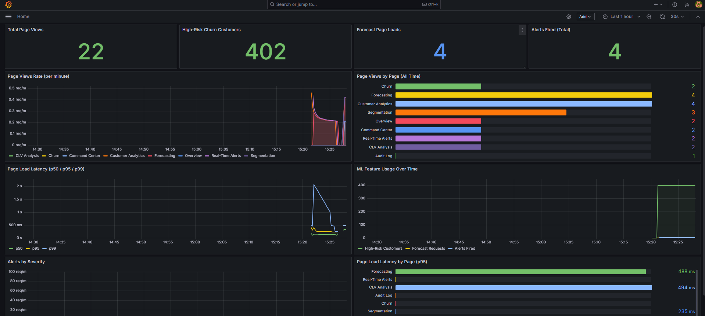

**Evidently drift report** — revenue drift detected across 2 of 3 monitored columns (66.7% share), the signal that triggers a gated retrain.
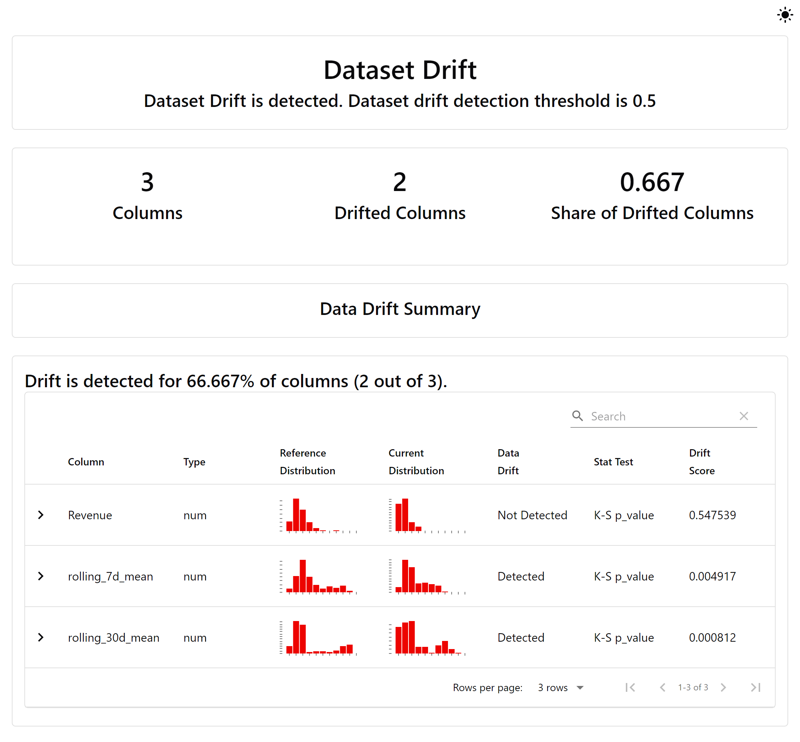

---

## 8. Visuals

### Live dashboard

**Command Center** — unified executive view with health scorecards, revenue-at-risk, and a recommendation engine.
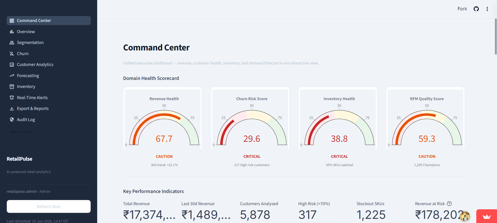

**Forecasting** — Prophet + LSTM hybrid demand forecast with what-if analysis.
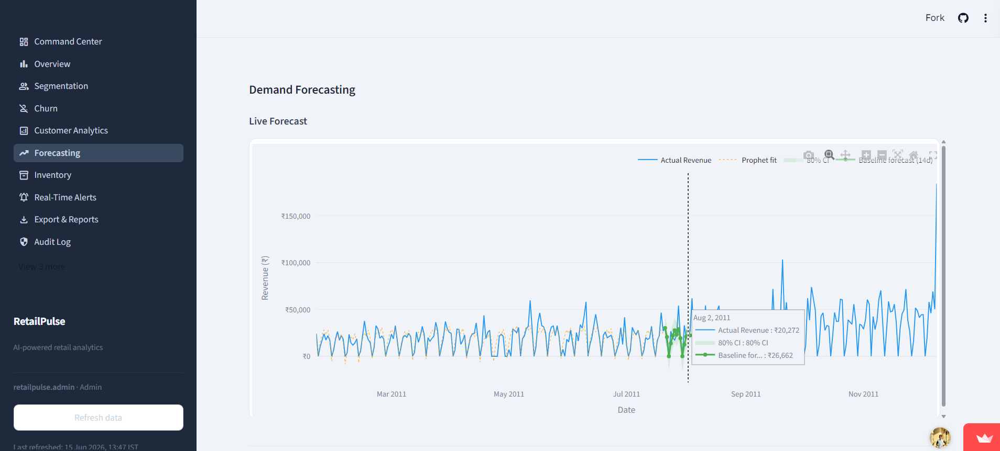

**Churn** — per-customer churn probabilities from the Optuna-tuned XGBoost model.
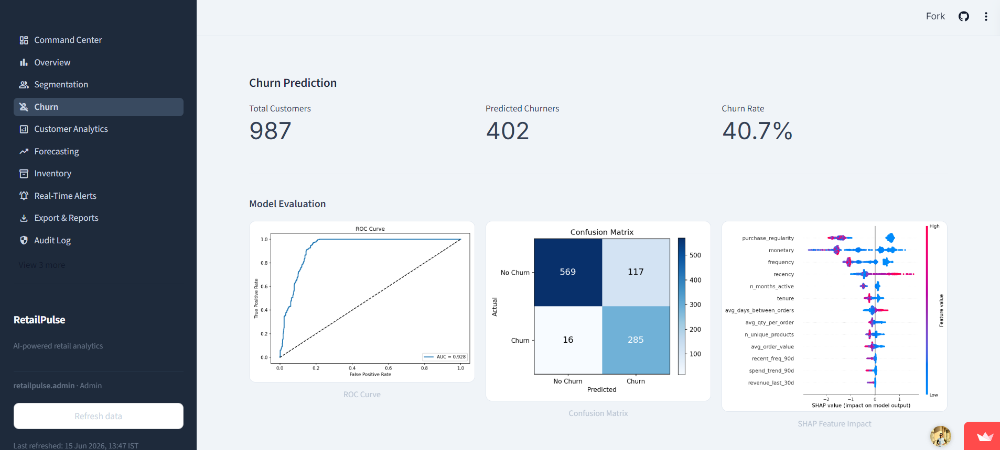

**Segmentation** — RFM scoring with K-Means / DBSCAN clusters, profiled by business value.
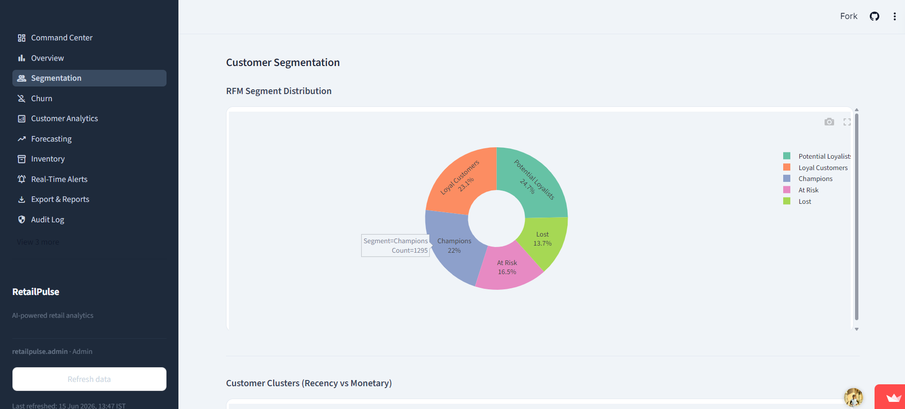

**Inventory** — reorder points, safety stock, and an urgency-tiered restock queue.
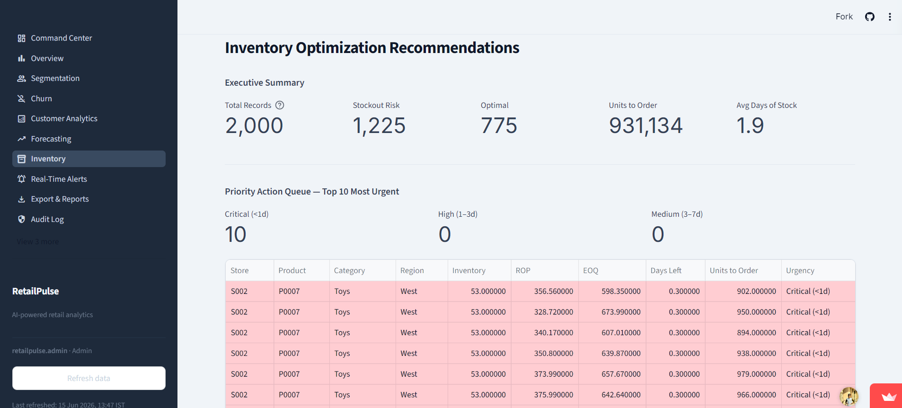

### Model outputs & EDA

**Hybrid forecast vs actuals**
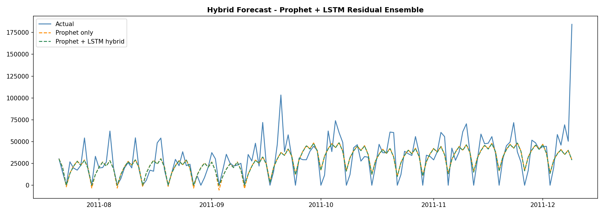

**Churn ROC curve**
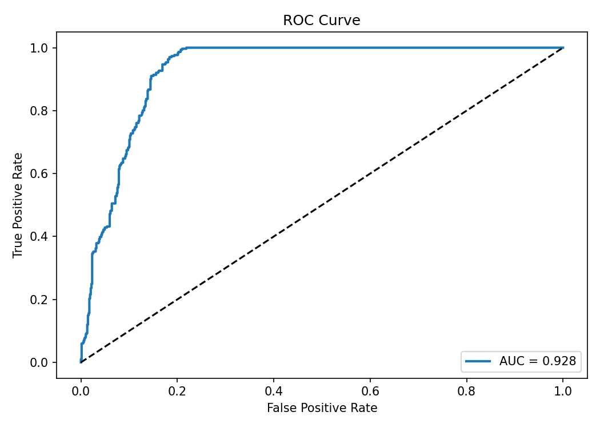

**Churn SHAP summary**
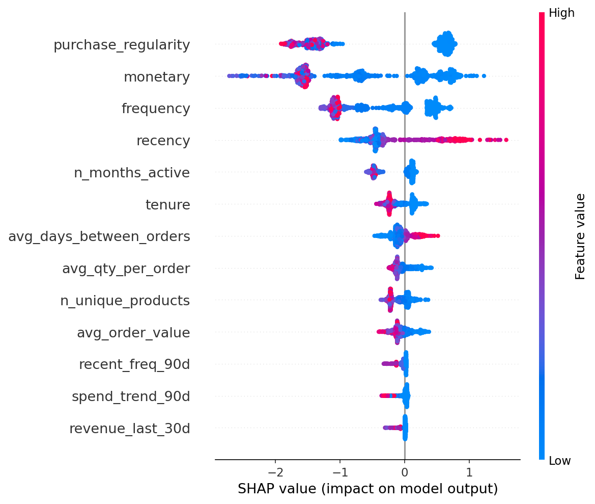

**Feature importance consensus**
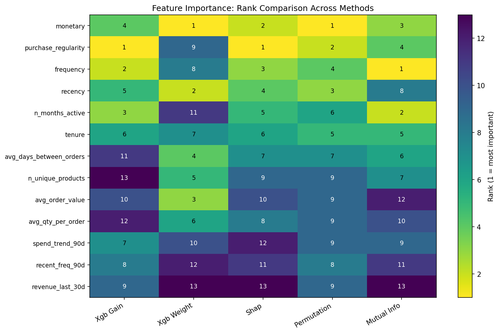

**Customer segments (K-Means)**
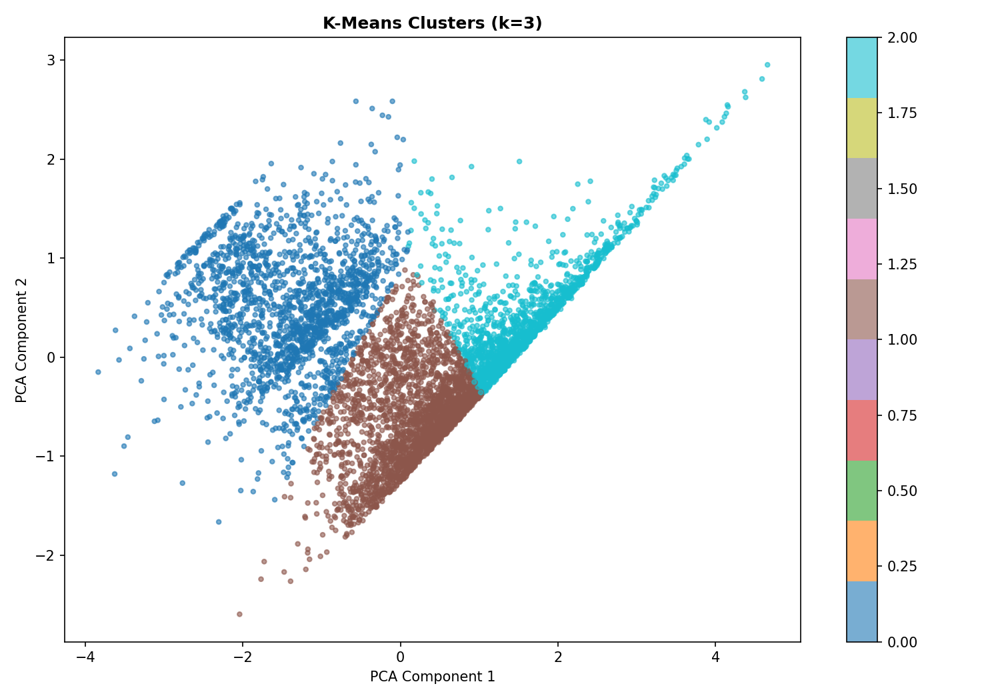

**Monthly sales trend (EDA)**
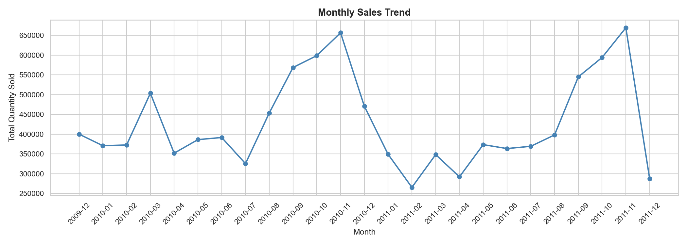

**Inventory stockout risk heatmap**
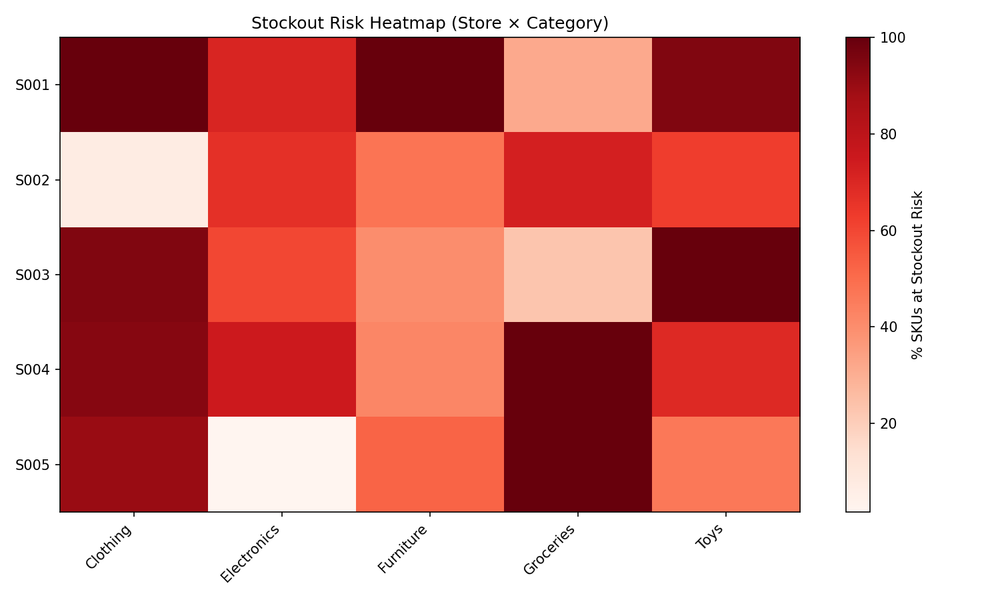

---

## 9. Personal Reflection

**Key learnings.**

- **Production ML is mostly engineering.** Data plumbing, fallbacks, authentication, deployment, and monitoring demanded far more effort than model training itself.
- **Hybrid models win when the signals differ.** Prophet captures seasonality while the LSTM models the residual non-linearity — together they outperform either model alone.
- **Honest metrics drive progress.** Reporting the true 31.2% forecast MAPE identifies the next optimization target far more usefully than a flattering number would.

**Industry best practices applied.**

- **Release-gated tracking** — MLflow baselines block any accuracy regression from reaching production.
- **Drift-triggered retraining** — Evidently and Airflow retrain models only on detected drift, behind an accuracy gate.
- **Graceful degradation** — a tiered Redis → PostgreSQL → CSV cascade keeps the application available under partial outages.
- **Automated quality gates** — CI enforces lint and tests; CD enforces an accuracy gate before every deploy.
- **Security by default** — role-based access control and strict secret hygiene throughout.

**Future roadmap.**

- **Improve forecast accuracy** — introduce exogenous regressors (promotions, holidays, weather) and per-category models.
- **Move to streaming ingestion** — replace batch CSV loads with continuous online data.
- **Add model-performance monitoring** — alert on prediction quality, not infrastructure metrics alone.
- **Measure intervention impact** — A/B test churn-prevention actions to quantify revenue retained.

---

*RetailPulse — built as a machine learning internship project at Zidio Development, June 2026.*
